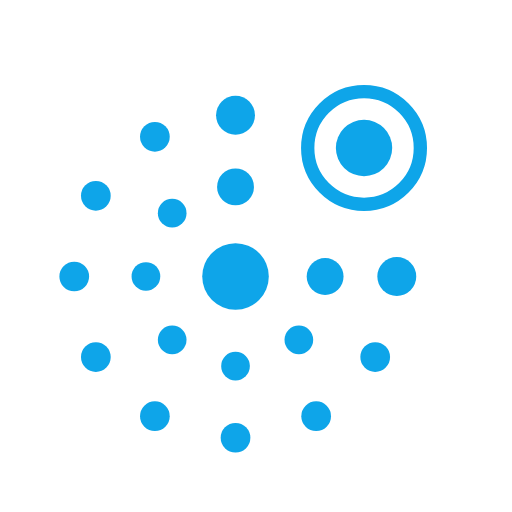

<div align="center">
  <picture>
    <source media="(prefers-color-scheme: dark)" srcset="static/perra-dark.svg" />
    <source media="(prefers-color-scheme: light)" srcset="static/perra-light.svg" />
    
  </picture>
  <h1>Perra (Persona Radar)</h1>
  <p>
    <strong>Collect a dossier on a person by username or identifier across thousands of websites — no API keys required.</strong>
  </p>
  <p>
    Built on the <a href="https://github.com/soxoj/maigret">Maigret</a> OSINT engine, packaged as a standalone Windows <code>perra</code> CLI with non-blocking update checks, self-update support, setup manager, and bundled AI agent skills.
  </p>
</div>

---

## Overview

**Perra** (short for **Persona Radar**) checks usernames and supported public identifiers against a bundled database of **9,535 sites**, extracts profile metadata (`fullname`, `bio`, `location`, linked usernames/IDs) with `socid-extractor`, performs optional recursive cross-platform pivoting, and exports structured intelligence reports in 9 formats.

Perra is designed for interactive analysts, security researchers, automated pipelines, and AI coding agents:

- **Global Windows Installer (`--onedir` + Inno Setup 6):** Installs `perra.exe` to `%LOCALAPPDATA%\Programs\Perra`, adds `perra` to user `PATH` (no Administrator privileges required), and optionally deploys the `perra` AI agent skill.
- **Non-blocking CLI Release Checks & Self-Update:** Every normal `perra` run checks GitHub Releases (`codevcn/perra`) via a detached background worker while reading `~/.perra/cli_update_state.json` locally so main CLI execution is never blocked; upgrade anytime with `perra update`.
- **Upstream Community Site Database Sync:** Automatically keeps the bundled site database synchronized with upstream [`soxoj/maigret`](https://github.com/soxoj/maigret) every 24 hours (cached in `~/.perra/data.json` and SHA-256 verified).
- **Zero-Dependency Setup Manager:** Cross-platform `scripts/setup_manager.py` (with Windows `setup.bat` and `setup.ps1` wrappers) provisions `.venv`, runtime + `[pdf]` + dev/test + PyInstaller dependencies, Inno Setup 6, and AI agent skills.

---

## Key Capabilities

| Area | Details |
| --- | --- |
| **Site Coverage** | **9,535** bundled site probes (`top 500` by default; full DB with `-a`) |
| **Identifier Types (12)** | `username`, `yandex_public_id`, `gaia_id`, `vk_id`, `ok_id`, `wikimapia_uid`, `steam_id`, `uidme_uguid`, `yelp_userid`, `orcid`, `qq_id`, `bilibili_id` |
| **Profile Extraction** | Parses public profile fields (`bio`, `fullname`, `uid`, linked URLs/handles) and follows extracted IDs recursively (`--no-recursion` to disable) |
| **Report Formats (9)** | **Default Atlassian Design System HTML UI** (`report_<user>_plain.html`, Light/Dark OS theme + instant scroll buttons, no auto-open; disable with `--no-html` or open with `--open-html`), JSON (`-J simple` / `-J ndjson`), Markdown (`-M`), PDF (`-P`), interactive `vis-network` Graph (`-G`), Neo4j Cypher (`--neo4j`), CSV (`-C`), TXT (`-T`), XMind (`-X`) |
| **Network & Anti-Bot** | Async HTTP (`aiohttp`) + TLS-impersonating `curl_cffi`, HTTP/SOCKS proxies (`-p`), Tor `.onion` (`--tor-proxy`), I2P ( `--i2p-proxy`), optional FlareSolverr (`--cloudflare-bypass`), selectable DNS resolver (`--dns-resolver async\|threaded`) |
| **Web UI & AI Summary** | Local Flask Web UI with live SSE progress (`perra --web 5000`) and optional OpenAI-compatible dossier summary (`--ai`) |
| **AI Agent Skill** | Built-in `skills/perra/SKILL.md` for **Antigravity**, **Codex**, and **Claude Code** |

---

## Installation

### Option 1: Windows Installer (Recommended for End Users)

Download `PerraSetup-0.1.0-win64.exe` (and `SHA256SUMS.txt` for verification) from [GitHub Releases](https://github.com/codevcn/perra/releases).

The installer (`PrivilegesRequired=lowest`):
1. Installs the PyInstaller `--onedir` distribution to `%LOCALAPPDATA%\Programs\Perra\`.
2. Adds that folder to your User `PATH` so `perra` is available globally from Command Prompt and PowerShell.
3. Installs the `perra` AI agent skill (checked by default) into:
   - Antigravity: `~/.gemini/config/skills/perra/SKILL.md`
   - Codex: `~/.codex/skills/perra/SKILL.md`
   - Claude Code: `~/.claude/skills/perra/SKILL.md`

Silent install:

```powershell
.\PerraSetup-0.1.0-win64.exe /VERYSILENT /SUPPRESSMSGBOXES /NORESTART
```

Verify installation in a **new** terminal:

```bash
perra --version
```

---

### Option 2: From Source via Setup Manager (Developers)

Requires **Python 3.10+** and `git`.

```bash
git clone https://github.com/codevcn/perra.git
cd perra
```

On Windows PowerShell / CMD:

```powershell
# Inspect environment, Python modules, Inno Setup 6, and AI skill directories
.\setup.bat doctor

# Create .venv, install perra[pdf] + dev/test tools + PyInstaller + skills, and run doctor
.\setup.bat setup-all
```

Or cross-platform with Python directly:

```bash
python scripts/setup_manager.py install
python scripts/setup_manager.py install-skills
python scripts/setup_manager.py doctor
```

Manual `pip` editable install:

```bash
python -m venv .venv
# Windows: .\.venv\Scripts\activate
# macOS/Linux: source .venv/bin/activate
pip install -e ".[pdf]"
```

---

## Quick Start

### Basic & Scoped Searches

```bash
# Scan top 500 sites for a username
perra johndoe

# Scan multiple usernames
perra alice bob

# Limit to specific sites or categories/country tags
perra torvalds --site GitHub --no-recursion
perra vitalik.eth --tags crypto --exclude-tags porn,dating

# Full database scan (~9,500+ sites)
perra johndoe -a

# Non-interactive agent / script friendly execution + structured reports
perra johndoe --no-progressbar --no-color -fo ./perra_out -J ndjson -M
```

> **Windows / VPN Tip:** If many sites report `Connecting failure (DNS)`, switch to the OS threaded resolver:
> ```bash
> perra johndoe --dns-resolver threaded
> ```

### Other Identifier Types & Batch Input

```bash
# Search by specific identifier type
perra 123456 --id-type vk_id

# Mixed targets from file (`id_type:value` per line, `#` comments ignored)
perra --input-file targets.txt -M

# Extract identifiers from a profile URL and search them
perra --parse https://github.com/torvalds
```

### Generate Interactive HTML UI & Additional Report Formats

Every CLI scan automatically saves an offline **Atlassian Design System HTML report** (`report_<username>_plain.html`) into `./reports/` (or `-fo PATH`) without opening a browser tab:

```bash
# Default run saves ./reports/report_torvalds_plain.html automatically (no browser launch)
perra torvalds --site GitHub --no-recursion

# Open the generated HTML report in your default browser once finished
perra torvalds --site GitHub --no-recursion --open-html

# Disable default HTML report generation (e.g., when streaming JSON only)
perra torvalds --site GitHub --no-recursion --no-html -J ndjson

# Combine HTML, PDF, Markdown, NDJSON, Graph, Neo4j Cypher, CSV, TXT, and XMind
perra torvalds --site GitHub --no-recursion -fo ./reports -P -X -J ndjson -M -C -T -G --neo4j
```

The HTML UI follows your OS theme (`prefers-color-scheme`) with a top-right Light/Dark toggle, Cards & Table views, `Confirmed` / `Similar` / `Errors / Unknown` tabs, and bottom-right instant Top/Bottom scroll buttons. Note `--open-html` is automatically suppressed when `--no-progressbar`, `CI`, or `PERRA_NO_OPEN=1` is active.

### Launch Local Web Interface

```bash
perra --web 5000
# Opens local Flask app at http://127.0.0.1:5000
```

---

## Updates: CLI Application & Site Database

Perra separates application updates from site-database updates:

### 1. Perra CLI Self-Update (`codevcn/perra`)

- **Background check on run:** On normal commands, Perra reads cached state (`~/.perra/cli_update_state.json`) immediately (`0 ms` network wait) and prints a notice on `stderr` if a newer GitHub Release exists, while spawning a detached `perra --_bg-update-check` subprocess in the background so your current command is never slowed or blocked.
- **Opt out of automatic checks:** Pass `--no-update-check`, set `PERRA_NO_UPDATE_CHECK=1`, or set `"cli_autoupdate_check": false` in `~/.perra/settings.json`.
- **Active update commands:**

```bash
# Check latest release on codevcn/perra without installing
perra update --check

# Interactive upgrade (frozen Windows installer verifies SHA256SUMS.txt before silent install)
perra update

# Non-interactive upgrade
perra update --yes

# Include prereleases / force reinstall
perra update --pre --force
```

### 2. Community Site Database Updates (`soxoj/maigret`)

Perra checks upstream `soxoj/maigret` `db_meta.json` at most once every 24 hours (cached in `~/.perra/data.json` with SHA-256 verification). Backward compatibility is maintained via `__db_compat_version__` in [perra/__version__.py](perra/__version__.py).

```bash
# Force immediate site database refresh
perra johndoe --force-update

# Skip upstream database refresh (offline / reproducible runs)
perra johndoe --no-autoupdate --no-update-check
```

---

## Configuration & State Paths

Settings are loaded and merged in increasing order of precedence:

1. Bundled `perra/resources/settings.json`
2. `/etc/perra/settings.json`
3. `~/.perra/settings.json`
4. `./settings.json` (current working directory)

User runtime state and caches live in `~/.perra/`:
- `data.json` — Cached site database downloaded from upstream
- `autoupdate_state.json` — Database sync state & 24h cooldown
- `cli_update_state.json` — Non-blocking CLI release check cache
- `activation.json` — Cached runtime activation credentials/tokens

---

## Packaging & Building Installers (Windows)

Build the PyInstaller `--onedir` bundle and compile the Inno Setup 6 installer (`PerraSetup-0.1.0-win64.exe` + `SHA256SUMS.txt`):

```powershell
# Build both dist\perra\perra.exe (--onedir) and dist\installer\PerraSetup-0.1.0-win64.exe
.\setup.bat build-all --clean

# Or individual stages:
.\setup.bat build-onedir --clean
.\setup.bat build-installer
```

`setup_manager.py` locates `ISCC.exe` via `PATH`, standard Windows installation directories, or the Windows Uninstall registry (`HKCU`/`HKLM`). Run `.\setup.bat install --with-inno` if Inno Setup 6 is not yet installed.

---

## AI Agent Integration (`skills/perra`)

The skill file [skills/perra/SKILL.md](skills/perra/SKILL.md) documents non-interactive invocation rules (`--no-progressbar --no-color`), default silent HTML UI output (`--no-html` to omit, never `--open-html`), structured output flags (`-J ndjson`, `-M`), DNS fallback on Windows, error interpretation (`CLAIMED` vs `AVAILABLE` vs `UNKNOWN`), and false-positive safeguards.

Deploy or refresh the skill manually for all three agents or a subset:

```bash
python scripts/setup_manager.py install-skills
python scripts/setup_manager.py install-skills --agents antigravity,codex,claude
```

---

## Development, Linting & Testing

```bash
# Run offline test suite
.\.venv\Scripts\python.exe -m pytest -m "not slow" tests

# Lint critical Python syntax/undefined-name checks
.\.venv\Scripts\python.exe -m flake8 perra scripts --count --select=E9,F63,F7,F82 --show-source --statistics

# Typecheck typed modules (updater, setup_manager, tests)
.\.venv\Scripts\python.exe -m mypy --check-untyped-defs --ignore-missing-imports --explicit-package-bases perra/updater.py scripts/setup_manager.py tests/test_updater.py tests/test_setup_manager.py
```

---

## Legal & Ethical Use

Perra queries publicly accessible URLs only. Use this tool strictly for authorized OSINT investigations, digital footprint audits of your own accounts, defensive security research, or testing in compliance with applicable laws and website terms of service.

---

## Attribution & License

Released under the [MIT License](LICENSE).

- **Perra (Persona Radar):** Maintained at [`codevcn/perra`](https://github.com/codevcn/perra).
- **Upstream Foundation:** Forked from and grateful to [**Maigret**](https://github.com/soxoj/maigret) created by [Soxoj](https://github.com/soxoj) and its contributors, whose site database and detection engines power Perra.
