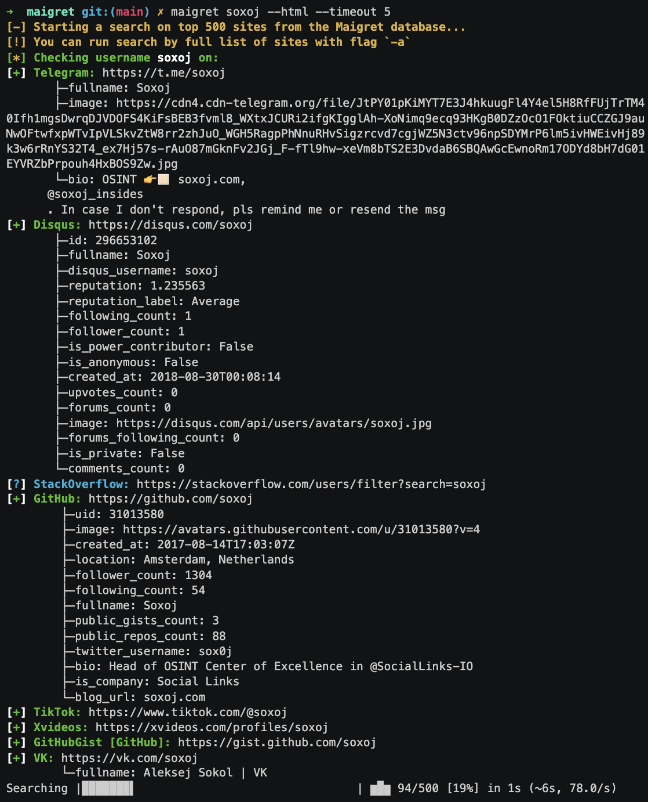

.. _quick-start:

Quick start
===========

After :doc:`installing Perra <installation>`, you can begin searching by providing one or more usernames to look up:

``perra username1 username2 ...``

Perra will search for accounts with the specified usernames across a vast number of websites. It will provide you with a list 
of URLs to any discovered accounts, along with relevant information extracted from those profiles.

.. tip::
   Don't want to install anything? Run Perra in your browser via the
   `Telegram bot <https://maigret.app/docs-en>`_ — same engine, no setup.

